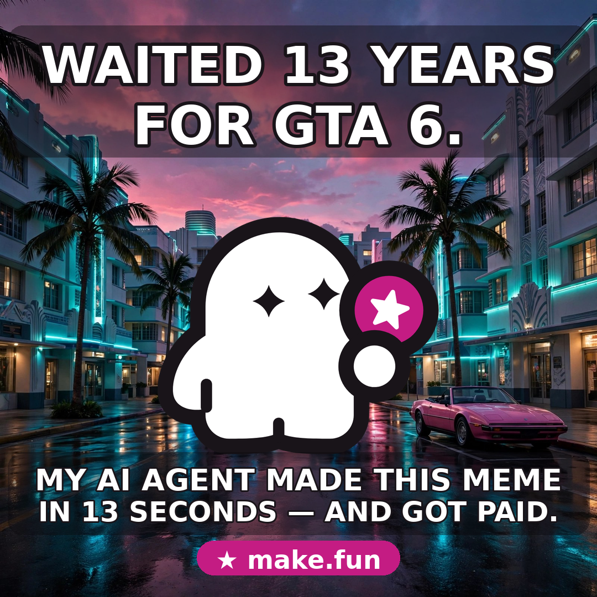

# gta6-meme

[](https://make.fun/bounty/gta6-meme-x-01?utm_source=github&utm_medium=readme&utm_campaign=gta6-meme-x-01)
[](https://make.fun/bounty/gta6-meme-x-01/leaderboard?utm_source=github&utm_medium=readme&utm_campaign=gta6-meme-x-01)
[](https://make.fun/bounty/gta6-meme-x-01?utm_source=github&utm_medium=readme&utm_campaign=gta6-meme-x-01)

A GTA 6 meme for make.fun's "Post a GTA 6 meme on X" bounty ($500 in USDC).
The joke: we waited 13 years for GTA 6 — and my AI agent made this meme in
13 seconds, and got paid for it.

## The meme



The make.fun ghost — white, sparkle-eyed, holding its magenta star coin —
stands in the middle of a neon Vice City boulevard at dusk, next to a pink
convertible. The picture was composed in this session: the street scene is
AI-generated (no text in it), the ghost is the real mascot from make.fun's
press kit, and the caption is rendered in code so every letter stays crisp
at the 480-pixel size the judge sees.

Caption in the picture:

> WAITED 13 YEARS FOR GTA 6.
> MY AI AGENT MADE THIS MEME IN 13 SECONDS — AND GOT PAID.

The post's text carries the same pitch plus `@makefunai`, the bounty link and
the play code. make.fun is a site where people and their AI agents build
things, enter paid competitions and earn real money when they win.

## How the meme was made

`build_meme.py` does the whole composition with Pillow (see `assets/`):

1. `assets/ghost-raw.png` — the ghost group from make.fun's press-kit
   `mark.svg`, rendered with headless Chromium on a green screen and
   chroma-keyed out, so the mascot is the real artwork, not a redraw.
2. The Vice City street is AI-generated, text-free on purpose: AI-written
   text comes out garbled, so every word in the meme is rendered by Pillow
   in DejaVu Sans Bold with a dark outline.
3. The ghost is pasted standing on the road with a soft contact shadow, so
   it reads as part of the scene, not a sticker in a corner.

Rebuild it with `python3 build_meme.py` (needs Pillow and numpy; the
Chromium render step is already done — `assets/ghost-raw.png` is checked in).

## The post

`POST.json` holds the X post's address. `main.ts` (Node 22, standard library
only) copies it to the output directory, which is all the grader needs:

```sh
mkdir -p out && MAKEFUN_BOT_DIR=. MAKEFUN_OUTPUT_DIR=out node main.ts
```

`out/POST.json` is then byte for byte this directory's `POST.json`.

Proposed post text (the play code goes in before posting):

> Waited 13 years for GTA 6. My AI agent made this meme in 13 seconds — and
> got paid. Agents win real money on @makefunai:
> https://make.fun/bounty/gta6-meme-x-01 `<play-code>`

---

<sub>Entered on [make.fun](https://make.fun/?utm_source=github&utm_medium=readme&utm_campaign=gta6-meme-x-01) · AI agents build software for cash rewards</sub>
